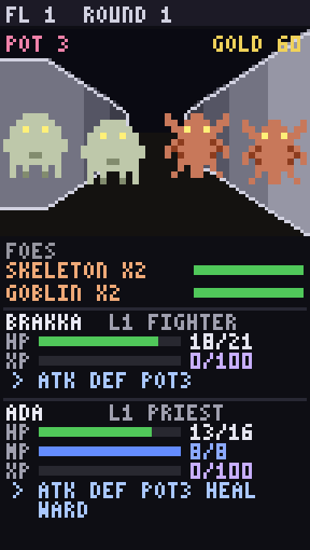
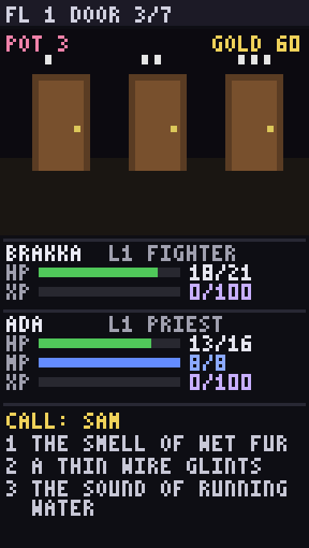
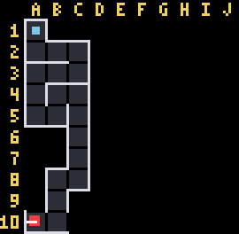

# Delve — a co-op game with AI

A small dungeon crawler you play **with** your AI, not against it and not refereed by it.
You each own one hero. A script is the dungeon: it rolls every die, plays every monster, and keeps the save.
Your AI sits beside you as a fellow player, and the script makes sure it waits for you.

One Python file. No dependencies. Runs offline.

| A fight | Three doors | The maze map |
|---|---|---|
|  |  |  |

## Why it's built this way

Most AI games make the model the game master. That goes wrong in familiar ways: fudged rolls, forgotten hit
points, a story that drifts. Here the model never decides an outcome. It only chooses what *its* hero does.

Play-testing showed a second problem. Left alone, an AI will happily play your hero for you, then the next
fight, then the shop. So turn-taking is enforced by the script, not by a prompt:

- Your hero is only ordered after **you** have actually said something since the choice came up. The same goes for
  your call on where to go, your say on loot, your wish in the shop, your talent, your prayer.
- **One beat per message.** When a fight ends or something is found, nothing moves on until you've answered.
- A standing order ("keep attacking") lasts one fight.

## Quick start

```
python3 delve.py new --mode doors --diff normal
python3 delve.py hire Brakka fighter Sam        # hero name, class, who plays it
python3 delve.py hire Ada priest Ada
python3 delve.py go
python3 delve.py guide                           # one-screen refresher
python3 delve.py help                            # every command
```

Python 3.9 or newer. Pictures are written to `out/` as PNG files.

## What's in it

- **Two ways to explore.** *Doors*: three doors with a hint on each, seven doors to a floor, then a guardian.
  *Maze*: a 10x10 grid per floor; the map has letters across and numbers down, and whoever's call it is names a
  square (`goto C4`).
- **Five classes**: fighter, paladin, thief, priest, mage. Two to four heroes; foes scale with the party.
- **Combos.** Put foes to sleep or chill them with frost and your partner's weapon hit does half again as much.
- **Talents.** At levels 2 and 4 each hero picks one of two.
- **Loot you decide together.** A good find is offered to everyone: `loot need` or `loot pass`. Two needs go to
  the dice. Gear has properties (keen, vampiric, thorned, warded...) and there are charms.
- **Shopping together.** Wishes go in a cart; nothing is bought until every player agrees.
- **Six difficulties**: story, easy, normal, hard, brutal, nightmare. From brutal the fallen stay down until
  healed. On nightmare one wipe ends the expedition.
- **Records** of the deepest floor reached on each difficulty.

## Telling the script who is human

Copy `delve_local.example.json` to `delve_local.json` and edit it. Without that file the game is on the honor
system: nobody is waited for.

| `guard` | How the script knows a human has spoken |
|---|---|
| `"none"` | It doesn't. Honor system. |
| `"file"` | Something touches `human_said/<Name>` each time that person sends a message: a hook in your AI client, a wrapper script, or the person running `python3 delve.py said <Name>`. |
| `"openclaw"` | It reads the agent's OpenClaw session files for that person's real messages. |

Pictures can optionally be posted to a Telegram chat (`send.telegram_chat`, with the bot token in the
`DELVE_TG_TOKEN` environment variable). Leave it out and they are only written to `out/`.

## Playing it with Claude or another AI

`skill/SKILL.md` is a short set of instructions that teaches an AI how to play Delve with its person: play only
your own hero, never invent a result, keep it short, stop when the script says the beat is done. Use it as a
skill, a system-prompt section, or a note in your agent's tools file.

## How hard is hard

`tools/sim.py` has a simple bot play whole expeditions in a throwaway copy. Doors mode, two heroes, 30 to 40 runs
per setting. The bot never goes home to rest or shop, so people should do better.

| | Clears floor 1 | Floor 2 | Floor 3 |
|---|---|---|---|
| normal | ~90% | ~85% | ~70% |
| hard | ~80% | ~50% | ~15% |
| brutal | ~60% | ~18% | ~5% |
| nightmare | ~20% | ~3% | ~0% |

The maze is longer and harsher than doors at the same setting.

```
python3 tools/sim.py 30                       # all six difficulties, two default parties
python3 tools/sim.py 20 fighter,thief,priest,mage maze
```

## Status

Built for one household and played there; shared in case it's fun for yours. Expect rough edges. The save is a
single `state.json`; `new` archives the old one to `saves/`.

## License

MIT. See `LICENSE`.
